<div align="center">

# 🛒 ShopSphere India
## E-commerce Profit Leak Analysis

**An end-to-end data analytics project using PostgreSQL, SQL and Python**

</div>

---

## 📑 Table of Contents
1. Project Overview
2. Dataset Summary
3. Tools and Technologies Used
4. Project Workflow
5. Data Cleaning
6. Stakeholder Questions, Key Findings and Recommendations
7. How to Reproduce and Run This Project
8. Skills Demonstrated
9. Author

---

## 📌 1. Project Overview

ShopSphere is a simulated Indian online marketplace. Its leadership noticed that sales were growing fast, but **profit stayed low (13.2% margin)**, repeat purchases were weak, customers complained about delivery, and returns and cancellations were high.

> 🎯 **Goal:** Find where the business loses money and recommend what to fix first, with an estimate of the impact.

### ✅ What this project does
- Loads **6 raw tables** into **PostgreSQL** and connects them to **Python**
- Profiles and cleans the data, fixing **21 data-quality issues** with a documented cleaning log
- Uses **SQL** and **pandas** to answer **12 stakeholder questions**, supported by **16 charts**
- Converts the findings into **5 prioritised recommendations** worth about **Rs 16.7 lakh per year** (roughly 45% of current annual profit)

### 📊 Headline numbers
| Metric | Value |
|---|---|
| 💰 Net revenue | **Rs 5.0 crore** |
| 📈 Profit | **Rs 75 lakh** (13.2% margin) |
| 📦 Delivered orders | **14,651** |
| 👥 Active customers | **5,719** |
| 🧾 Average order value | **Rs 3,885** |
| ↩️ Item return rate | **11.9%** |
| ❌ Cancellation rate | **4.1%** |
| 🚚 RTO (return-to-origin) rate | **3.2%** |

---

## 🗂️ 2. Dataset Summary

Six raw tables, stored in PostgreSQL and provided as CSV files in `data/`.
📅 **Period covered:** January 2024 to December 2025

| Table | Raw rows | Clean rows | Description |
|---|---|---|---|
| `customers` | 6,060 | 6,000 | Customer profile, city, acquisition channel |
| `products` | 140 | 140 | Category, supplier, MRP, cost price |
| `orders` | 16,389 | 16,165 | Order dates, status, payment method, courier, coupon, rating |
| `order_items` | 27,043 | 26,953 | Products, quantity and price in each order |
| `returns` | 2,915 | 2,902 | Returned items, reason, refund amount |
| `marketing_spend` | 168 | 168 | Monthly spend, clicks and new customers by channel |
---

## 🛠️ 3. Tools and Technologies Used

| Tool | Purpose |
|---|---|
| 🐘 **PostgreSQL 16** | Stores the raw and the cleaned tables |
| 🖥️ **pgAdmin 4** | Creates the database, runs `schema.sql`, imports CSV files, checks row counts |
| 📓 **Anaconda / Jupyter Notebook** | Main workspace for cleaning, analysis, charts and written insights |
| 🐍 **Python 3** | Analysis language |
| 🧮 **pandas, numpy** | Cleaning, joins, aggregation, metrics |
| 📊 **matplotlib, seaborn** | Charts and heatmaps |
| 🔌 **SQLAlchemy, psycopg2** | Connect Python to PostgreSQL |
| 🗃️ **SQL** | JOINs, CTEs, CASE, window functions |
| 🌐 **Git and GitHub** | Version control and portfolio hosting |

---

## 🔄 4. Project Workflow

1. **🏗️ Set up the database.** Installed PostgreSQL 16 and pgAdmin 4, created the `shopsphere` database, ran `schema.sql` to create the raw tables, imported the CSV files, and verified the row counts with a `UNION ALL` query.
2. **🔗 Connect Python to PostgreSQL.** Created a SQLAlchemy engine in Jupyter and loaded every table with `pd.read_sql`. The password is entered at run time with `getpass`, so no credentials are stored in the notebook.
3. **🔍 Profile the data.** Used `.info()`, `.isnull().sum()`, `.describe()` and `.value_counts()` on every table to find problems before fixing anything.
4. **🧹 Clean the data.** Worked on copies of the tables and logged every fix with the number of rows affected. Ran an integrity check (every item has an order, every order has a customer, every return has an item).
5. **💾 Save the clean tables to PostgreSQL** as `clean_*` tables, keeping the raw tables untouched.
6. **🗃️ Run SQL analysis** on the clean tables: revenue by category (JOINs), top customers, repeat-buyer rate by channel (CTE and CASE), courier performance, and best products per category (window function `RANK()`).
7. **🧱 Build one analytical dataset** with one row per item sold (26,953 rows), joining items, orders, products, customers and returns, and creating the metrics below.
8. **❓ Answer 12 stakeholder questions** with pandas and charts, following the pattern: question, calculation, chart, insight, recommendation.
9. **💡 Estimate the business impact** of each recommendation using explicit, adjustable assumptions.
10. **🚀 Publish** the notebook, charts and this README on GitHub.

### 📐 Metric definitions
- **Sales value** = quantity x unit price x (1 - discount %)
- **Net revenue** = sales value - refunds
- **Profit** = net revenue - cost of goods sold
- **Profit margin** = profit / sales value
- **CAC** = marketing spend / new customers, and **LTV/CAC** = profit per customer / CAC
- **Late delivery** = more than 5 days from order to delivery
- Only **delivered** orders count as revenue

### 📝 Assumptions
- 50% of the cost of a returned item is recovered by restocking
- Each RTO order costs Rs 150 in shipping and handling

---

## 🧹 5. Data Cleaning

Cleaning was done on **copies** of the tables, with a log of every fix. Empty values that are **not errors** were left alone: no coupon (empty `coupon_code`), no rating, and no delivery date for cancelled or undelivered orders.

| Table | Issue found | Rows affected | Action |
|---|---|---|---|
| customers | Inconsistent city names (Bombay, BLR, Calcutta) | 639 | Mapped aliases to 15 standard cities |
| customers | Gender spelling variants and missing | 4,573 | Mapped to Male / Female / Unknown |
| customers | Impossible age (below 18 or above 80) | 12 | Set to missing |
| customers | Missing age | 585 | Filled with the median (31) |
| customers | Missing or invalid email | 346 | Set to missing (not guessed) |
| customers | Phone in mixed formats | 1,053 | Kept the last 10 digits |
| customers | Duplicate customer records | 60 | Dropped, kept first ID |
| products | Category spelling variants | 11 | Standardised to 7 categories |
| products | Missing cost price | 4 | Estimated from the category's median cost/MRP ratio |
| products | Missing brand | 2 | Filled with "Unknown" |
| orders | Exact duplicate rows | 194 | Dropped |
| orders | Delivery date earlier than order date | 40 | Set to missing |
| orders | Payment method spelling variants | 2,060 | Standardised to 6 methods |
| orders | Shipping fee outliers (above 200) | 25 | Replaced with the typical fee |
| orders | Missing courier | 318 | Filled with "Unknown" |
| orders | Orders with an unknown customer | 30 | Dropped |
| order_items | Invalid quantity (zero, negative or above 10) | 30 | Dropped |
| order_items | Unit price of 0 | 15 | Dropped |
| order_items | Items of removed orders | 45 | Dropped |
| returns | Returns of removed items | 13 | Dropped |
| marketing_spend | Month stored as text | 168 | Converted to a real date |

> 📅 Order dates arrived in **three formats** (`2025-07-26`, `16/07/2025`, `27-May-2025`) and were parsed one format at a time to avoid day/month mix-ups.

---

## 💼 6. Stakeholder Questions, Key Findings and Recommendations

### Q0 . KPI'S

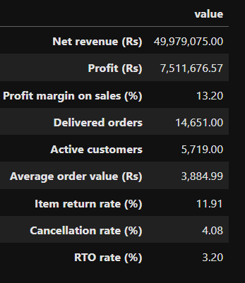

### 📈 Q1. CEO: Is the business growing, and is it growing profitably?

**🔎 Findings**
- Monthly net revenue grew from about **Rs 3.5 lakh** (Jan 2024) to about **Rs 65 lakh** (Oct 2025), and monthly orders from about 80 to almost 2,000.
- Growth comes from **more orders**, not bigger orders.
- Profit stays small: **Rs 75 lakh on Rs 5.0 crore** of net revenue, a **13.2% margin**.

**✅ Recommendation:** Find where profit leaks before pushing for more growth.

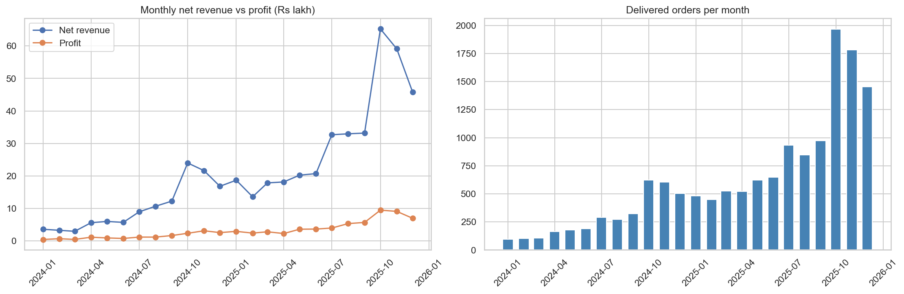

---

### 🗓️ Q2. Marketing: When do customers buy?

**🔎 Findings**
- **October and November bring 34%** of total net revenue, and the high-demand period runs from October to December.
- **Weekends are the busiest days** (Saturday and Sunday about 2,350 orders each, against about 1,900 to 2,075 on weekdays).

**✅ Recommendation:** Prepare stock and courier capacity before October, plan the biggest marketing push for October to December, and run promotions on weekends.

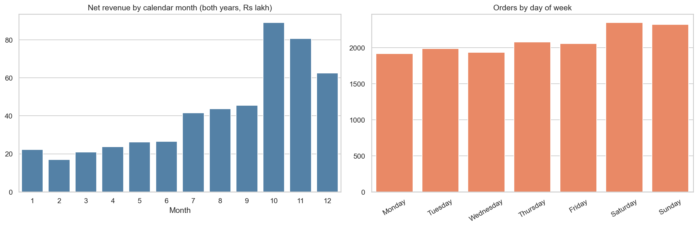

---

### 🏷️ Q3. Merchandising: Which product categories make money?

**🔎 Findings**
- **Electronics brings 48.8% of net revenue but has a -4.5% margin** (a loss of Rs 12.3 lakh).
- **Beauty earns a 55.2% margin** and Fashion 33.2%.
- Footwear, Fashion and Beauty bring about 32% of revenue but about **85% of profit**.
- **Footwear has the highest return rate (22.5%)**, followed by Fashion (17.0%).

**✅ Recommendation:** Fix Electronics pricing before pushing more sales, focus marketing on Beauty and Fashion, and reduce Footwear returns.

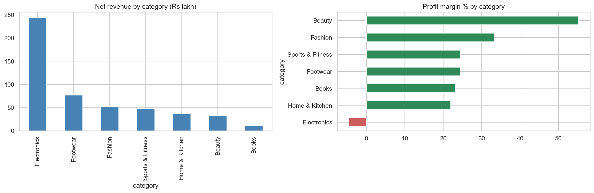


---

### 💸 Q4. Pricing: Are discounts and coupons destroying margin?

**🔎 Findings**
- Margin falls as discounts grow: **18.2%** with no coupon, 10.7% at 10%, 7.1% at 15%, 2.6% at 20%, and **-9.5% at 30%**.
- **Electronics is the only category that turns loss-making**: from 2% margin with no discount to **-36%** at a 30% discount.
- **2,285 items** that were kept (not returned) still sold at a loss of **Rs 11.6 lakh**, about 99% of it in Electronics.

**✅ Recommendation:** Remove Electronics from coupon offers, and keep deep coupons such as FLASH30 for high-margin categories like Beauty and Fashion.

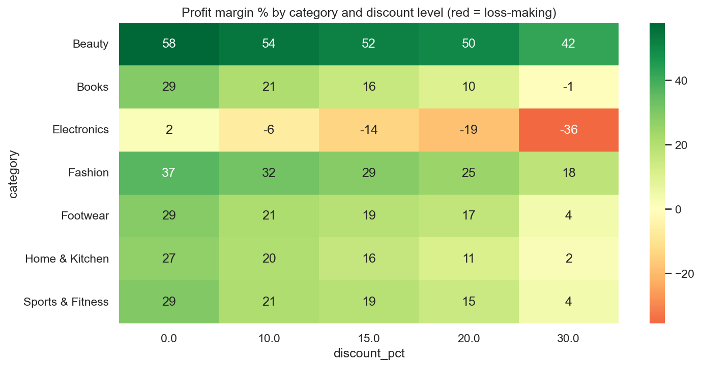

---

### 📣 Q5. Marketing head: Which acquisition channels give the best return?

**🔎 Findings**
- **Instagram Ads takes 45% of marketing spend but returns only 14% of profit** (CAC Rs 581, profit per customer Rs 726, LTV/CAC 1.25, repeat rate 42%).
- **Email** (LTV/CAC 44.5, 84% repeat rate), **Organic Search** (26.5) and **Referral** (11.1) are far more efficient.
- **Google Ads** is the best paid channel (LTV/CAC 3.36, 68% repeat rate).

**✅ Recommendation:** Reduce Instagram spend and move part of it to Google Ads. Invest in Email, a referral programme and SEO.

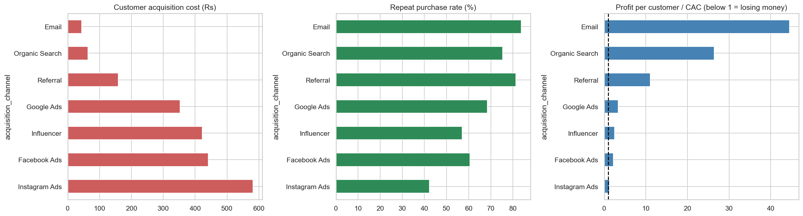
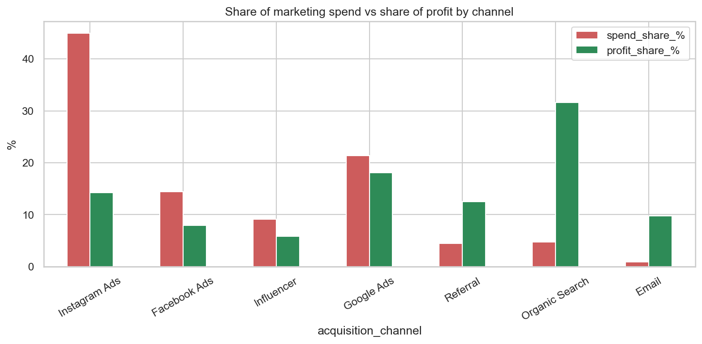

---

### 🔁 Q6. CRM: Do customers come back after their first purchase?

**🔎 Findings**
- Only about **14%** of customers buy again in the month after their first order.
- Retention stays between 10% and 20% in later months, with the **highest values every October** (festive season).

**✅ Recommendation:** Send a second-purchase offer within 30 days, run re-engagement campaigns before October and the July sale, and start a loyalty programme.

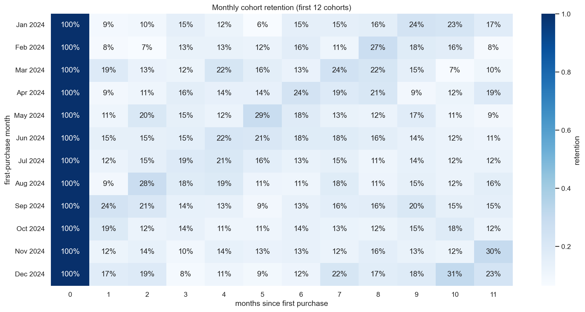

---

### ↩️ Q7. Operations: Why are returns high?

**🔎 Findings**
- Footwear (22.5%) and Fashion (17.0%) have the highest return rates. **Electronics has the largest refund value** (Rs 27.5 lakh, about 40% of Rs 69 lakh in total refunds).
- **Supplier S07 returns 24% of its items** against 6.3% for peers in the same category, and **82% of its returns are defects**.
- **Size and fit** is the main reason for 60% of Footwear returns and 51% of Fashion returns.

**✅ Recommendation:** Audit supplier S07, add size charts and fit guides for Footwear and Fashion, and improve product descriptions for Beauty and Books.

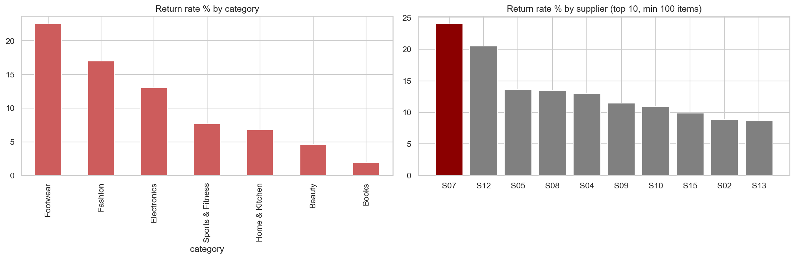
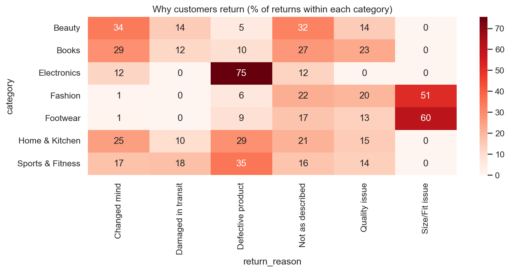

---

### 🚚 Q8. Logistics: Which couriers and cities hurt delivery and ratings?

**🔎 Findings**
- **XpressBees** takes **5.96 days** on average, is late on **49.3%** of orders, and has a **3.72** rating. BlueDart takes 3.38 days, is late on 9.6%, and has a 4.35 rating.
- **Slower delivery means lower ratings**: ratings fall steadily after 4 days.
- Every courier is slower in Tier-2 cities. XpressBees takes about **10 days in Guwahati, Lucknow and Patna**.

**✅ Recommendation:** Move orders for those cities to faster couriers, add delivery-time penalties to the XpressBees contract, and keep XpressBees only in metro cities.

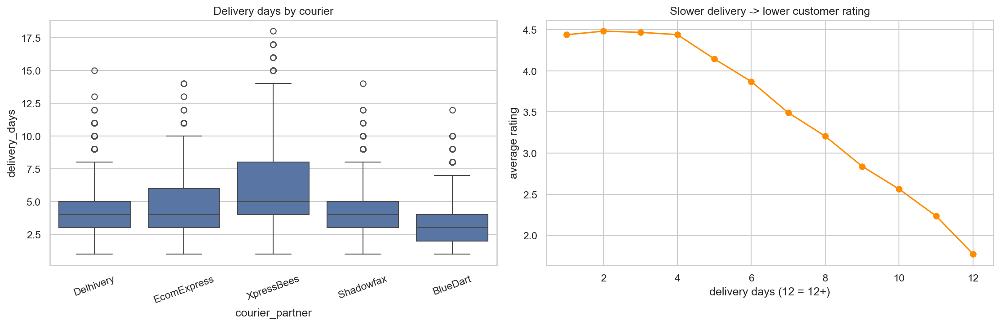
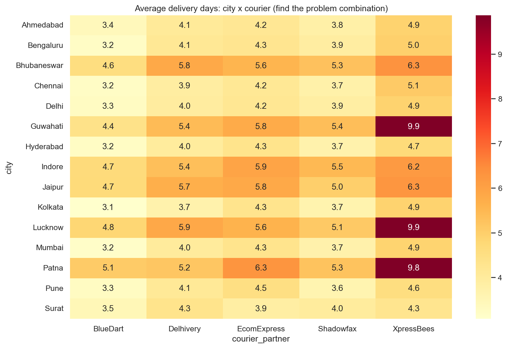

---

### 💳 Q9. Finance: Which payment methods cause cancellations and losses?

**🔎 Findings**
- **12.1% of COD orders** are returned undelivered (RTO). Every prepaid method has **0%**.
- Only 84.0% of COD orders are delivered, against about 96% for prepaid methods.
- Cancellations are about 4% for every method, so they are **not linked to payment type**.
- **517 RTO orders** left **Rs 22.2 lakh** of order value stuck (estimated cost Rs 77,550 at Rs 150 per order).

**✅ Recommendation:** Offer a discount for paying online, and confirm COD orders by OTP or WhatsApp before dispatch.

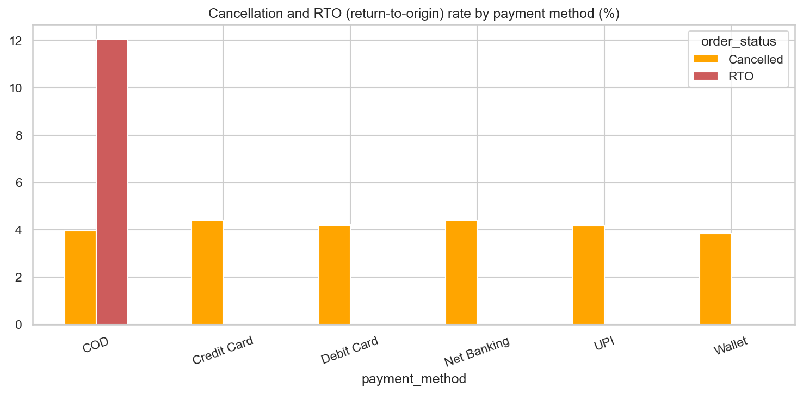

---

### 👑 Q10. CRM: Who are our best customers, and who are we losing?

**🔎 Findings**
- The **top 10% of customers bring 40%** of net revenue.
- **Champions** (1,005 customers) bring 31.8% of revenue. **At Risk (high value)** customers (1,243) hold **27.7%** of revenue but have not bought recently.
- Email and Referral bring the most Champions. **Instagram Ads has only 5% Champions and 34% Lost customers.**

**✅ Recommendation:** Run a win-back campaign for At Risk customers, give Champions loyalty rewards, and send New customers a second-purchase offer.

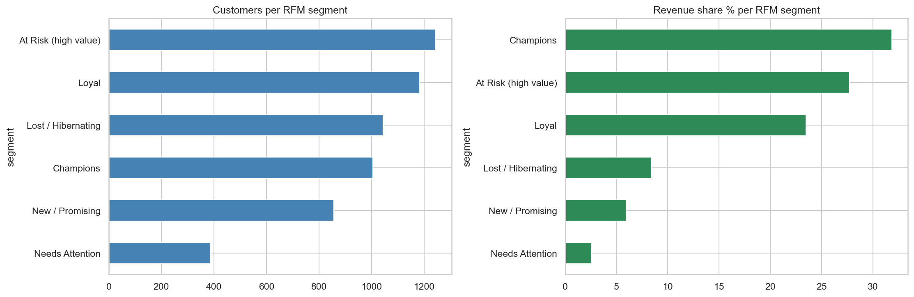
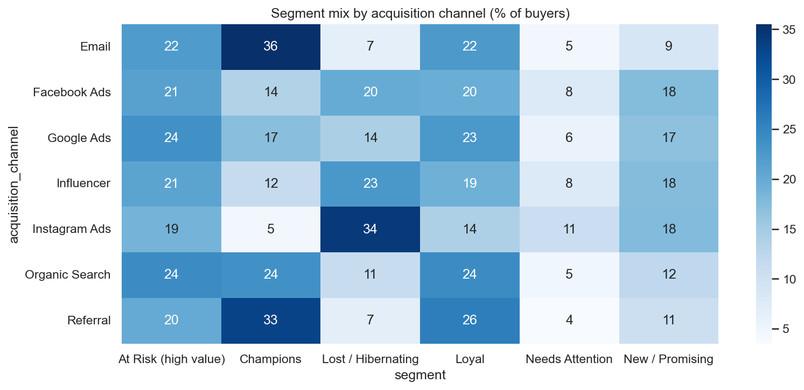

---

### 🌆 Q11. Regional team: Which cities perform best and worst?

**🔎 Findings**
- **Mumbai, Bengaluru and Delhi bring about 41%** of revenue. Bengaluru is the most profitable city.
- Return rates are similar in every city (11.3% to 13.4%).
- **Lucknow, Patna and Guwahati** deliver in about 7 days with ratings near 3.4, and Jaipur, Indore and Bhubaneswar in about 5.7 days. Big cities deliver in about 4 days with ratings above 4.1.

**✅ Recommendation:** Fix courier choice in the slow cities and keep investing in the three biggest cities.

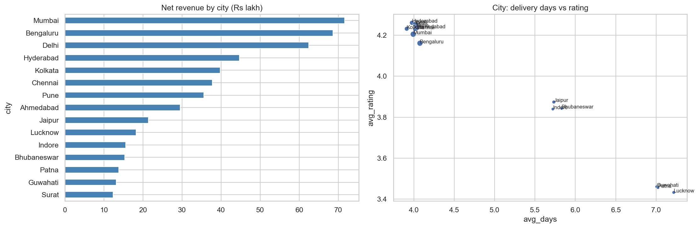

---

### 🎯 Q12. Leadership: What should we fix first, and what is it worth?

| Priority | Action | Estimated yearly impact |
|---|---|---|
| 🥇 1 | Audit supplier S07 (defective Electronics) | about **Rs 8.5 lakh** |
| 🥈 2 | Stop 20-30% coupons on Electronics and thin-margin items | about **Rs 2.9 lakh** |
| 🥉 3 | Size guides and fit reviews for Footwear and Fashion | about **Rs 2.8 lakh** |
| 4 | Move 30% of Instagram budget to Google Ads | about **Rs 2.4 lakh** |
| 5 | Prepaid incentive and confirmation for COD orders | about **Rs 0.1 lakh**, plus fewer undelivered orders |

### 💰 Total: about Rs 16.7 lakh per year (roughly 45% of current annual profit)

> ⚠️ These are estimates based on the stated assumptions, not guaranteed results. Refund-based savings represent revenue protected, so the real profit gain would be lower.

**🏁 Conclusion:** The profit problem is **not a lack of sales**. It comes from a few fixable leaks: a defective supplier, loss-making discounts on Electronics, high Footwear returns, and an expensive Instagram channel.

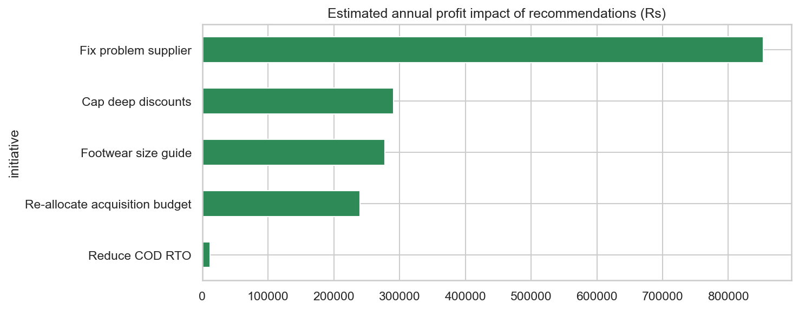

---

## ▶️ 7. How to Reproduce and Run This Project

**📋 Requirements:** PostgreSQL 16, pgAdmin 4, Anaconda (Python 3)

### 📁 Repository contents
```
shopsphere-ecommerce-analysis/
├── Shopsphere.ipynb        # Full analysis: cleaning, SQL, EDA, insights
├── schema.sql              # Creates the raw tables in PostgreSQL
├── load_to_postgres.py     # Optional script to bulk-load the CSV files
├── data/                   # 6 raw CSV files
├── charts/                 # 16 saved charts
└── README.md
```

### 🪜 Steps
1. **Create the database.** In pgAdmin, create a database named `shopsphere`.
2. **Create the tables.** Open the Query Tool on `shopsphere`, load `schema.sql` and run it.
3. **Import the data.** For each table, right-click it, choose **Import/Export Data**, select the matching CSV in `data/`, set the format to CSV and the header to Yes.
   Alternatively, edit the password in `load_to_postgres.py` and run `python load_to_postgres.py`.
4. **Install the libraries** in Anaconda Prompt:
   ```
   pip install psycopg2-binary sqlalchemy
   ```
5. **Run the notebook.** Start `jupyter notebook`, open `Shopsphere.ipynb`, and run the cells from top to bottom. The connection cell asks for your PostgreSQL password.
6. The notebook saves the cleaned tables back to PostgreSQL as `clean_*` tables and saves all charts to `charts/`.

---

## 🧠 8. Skills Demonstrated

- 🗃️ **Database:** PostgreSQL setup, schema design, data import, SQL (JOINs, CTEs, CASE, window functions)
- 🧹 **Data cleaning:** duplicates, mixed date formats, outliers, inconsistent categories, missing values, referential integrity checks, cleaning log
- 📊 **Analysis:** KPI design, cohort retention, RFM segmentation, CAC and LTV, margin analysis, return and delivery analysis
- 🎨 **Visualisation:** line, bar, box, scatter and heatmaps with matplotlib and seaborn
- 💡 **Business thinking:** metric definitions, stated assumptions, prioritised recommendations with estimated impact
- 🗣️ **Communication:** stakeholder-driven structure, with each insight tied to a chart and a table

---

## 👨‍💻 Author

**Mayank Singh |
Aspiring Data Analyst | SQL | Power BI | Excel | Python**

Passionate about transforming raw data into meaningful insights through data cleaning, exploratory data analysis, visualization, and business reporting.

Currently seeking entry-level Data Analyst opportunities where I can apply my analytical and technical skills to solve real-world business problems.

GitHub: https://github.com/MayankSingh2000

LinkedIn: www.linkedin.com/in/mayank-singh-aaa112135

---

⭐ If you find this project useful, feel free to explore the files, documents and its analytical findings.

**Thank you for visiting!**
